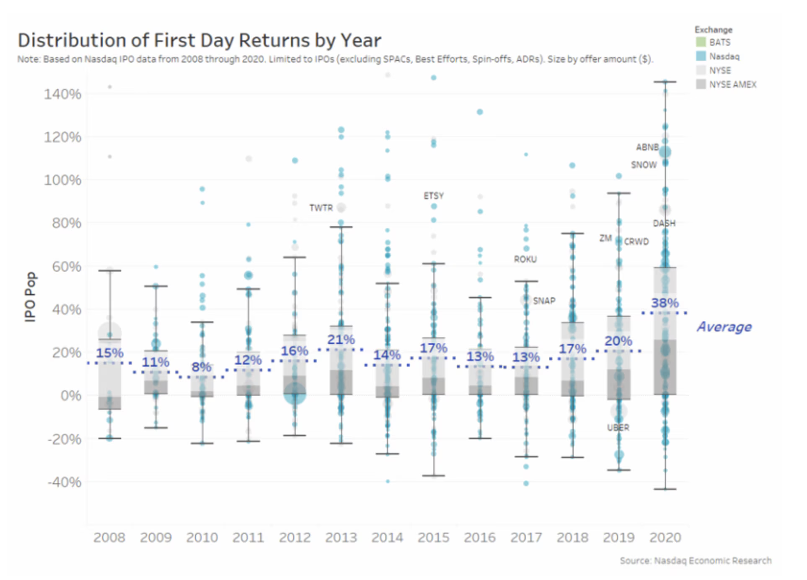
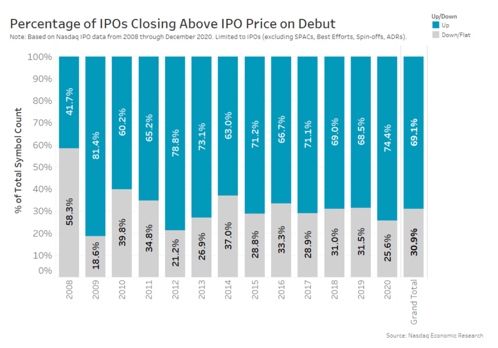
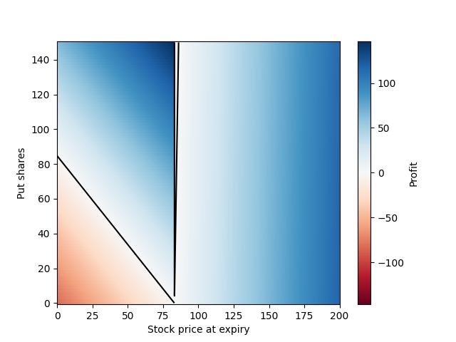
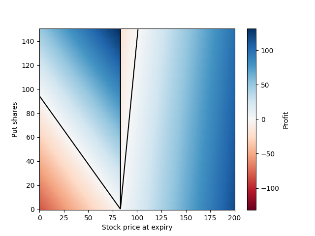

It's not a very revolutionary idea to hedge with prediction markets, but I wanted to pace it out for myself.

## Idea
The idea is to hedge an IPO position using a prediction market position. There is a prediction market contract that is the same as a binary put @ 83.00, ANT's IPO price.

A few days before the IPO, the price of a "No" contract was hanging around 0.12. This figure is the same as the market probability that ANT price closes below or at IPO price. 0.12 seems low to me, but I don't know much about IPOs.

I also anticipate that people will be overly interested in buying "Yes" because it was hard to get your hands on stock during the IPO. So, if you're some cheeseball retail trader who wants exposure to ANT, it might be the easiest way.

It was 6x oversubscribed; it's going to open high, clearly. People might be interested in some kind of downside protection even if there's not some dream arbitrage opportunity.

## Why do I suspect the probability is wrong?
It's just a weak intuition based on looking at other tech IPOs for now, but I will try to support it mathematically later.

The figure of 0.12 is below market average for this kind of bet. There is plenty of data to support the notion that the probability of closing below IPO price, for the mean IPO, is not as low as 0.12. However, these statistics don't contain all of the information that we had as of the 16th.

Figures from Nasdaq.[^1]

| Year | Number of IPOs | Mean First-day Return | % with First-day Return < 0% | % with First-day Return = 0% | Aggregate Proceeds (USD billions) | Market Value at 1st Closing Price (USD billions) |
|------|---------------:|----------------------:|-----------------------------:|-----------------------------:|----------------------------------:|------------------------------------------------:|
| 2020 | 165 | 41.6% | 19.4% | 2.4% | 61.86  | 687   |
| 2021 | 311 | 32.1% | 24.4% | 4.2% | 119.36 | 1,205 |
| 2022 | 38  | 48.9% | 39.5% | 2.6% | 6.99   | 73    |
| 2023 | 54  | 11.9% | 53.7% | 3.7% | 11.92  | 115   |
| 2024 | 73  | 15.3% | 34.7% | 4.2% | 20.90  | 137   |
| 2025 | 90  | 29.3% | 24.4% | 2.2% | 38.97  | 421   |

Table data from Jay Ritter's IPO statistics.[^2]

## Market State
I can't actually pull the full orderbook from Polymarket, but I have the information we need. Here's a small timeline:

### 11/16/2026
"Anthropic IPO: Closing Price above IPO Price on First Day?"
- No: $0.12 ask for a payout of $1
- Yes: $0.91 ask for a payout of $1

### 11/18/2026
- ANT IPO price declared $83.00

### 11/19/2026, 11:48 EST
- ANT opening price declared $111.50 by Nasdaq
- No: ~$0.02 ask
- Yes: ~$0.99 ask

## Hedging Procedure
Let's say you sourced one share of ANT during the IPO. We'll model your profit at the first day's close, S, across a range of prices.

Position:
- Long 1 ANT @ IPO price K
- Long N "No" shares @ p

Each "No" share pays 1 dollar if ANT closes at or below K, and nothing otherwise. So your profit at the close is 

$(S - K) - Np + (N)I(S<=K)$

where I is the indicator function for S <= K. In words: stock return, minus hedge price, plus hedge payout.

Here's how it looked on the 19th:

## Vital interpretation(don't skip!!!)
That profit chart seems very juicy to me. It looks too good to be true, because it is.

By the time this hedge was available, you already knew the opening price and could hypothetically sell for nearly $28.5 of profit. You should be comparing this profit chart with locking in a 34.3% return, and all of a sudden this chart is a lot less attractive. We have to go back in time, or else we have a kind of lookahead bias working against us.

## The same hedge, on the 16th 
Remember, we don't know the IPO price yet. The chart still assumes it's priced at $83, but it's arbitrary; just pretend the $83 is a different number, and the payoff plot is the same, only it would extend for more or less distance to the left.

Clearly a bit worse. This one cuts out the aforementioned lookahead bias a bit better. It still looks like the kind of profit chart that has a use case. 

## The stronger problem
Another problem is that closing price is simply not a nice probability distribution. I didn't know this because I have avoided IPOs like the plague on the advice of Benjamin Graham, but there are multiple safeguards (related to options held by the underwriters) that allow the price to be propped up at $83.00 during the first day. This is explicitly allowed by the SEC.

So, the real life probability of the price landing at a small amount above $83 is much higher than it would be for most stocks on most days. This explains why so much of the profit chart can look so great, with only that tiny zone above 83 hurting you; it's artificially much more probable you end up there.

## Arbitrage?
It doesn't look like there's an arbitrage opportunity here, unless there's one between different dates on similar markets, e.g. "Below IPO price by MM-DD-YYYY" for multiple times, or one with some kind of derivative equivalence with which I'm not familiar. 

There could be a real chance of arbitrage when actual options are available, such as if the prediction market share for strike K is worth a significantly different amount than buying a very tight put or call spread around K. Once again, options weren't being traded yet, so I can't really check.

## What is this strategy good for?
The real utility of this is it allows you to hedge on the day of nicely before there were options available to buy. "No" prices tanked over the few days preceding market open, due to the actual IPO price announcement. By the time you could actually trade ANT on the market, a "No" was worth about $0.02. 

So, you could get same-day catastrophic downside protection for pretty cheap. I can imagine this being useful to:
- someone interested in insuring a large position's loss against some kind of massive selloff. Maybe you would take it if you seriously suspected this was some insane exit liquidity play by private ANT holders. 
- someone facing some kind of penalty for specifically first day trading, and wants to be protected against downside while his hands are tied.
- someone facing a liquidity constraint, who can't buy anything right now and has instead sourced a forward or some other such contract. 
- some kind of fund manager (I'm thinking of Leopold Aschenbrenner as I write this) who wants to loudly acquire a huge chunk of potentially leveraged ANT for PR reasons, but also is worried about a huge wipeout and cannot afford posting a day one loss, again for PR reasons. People will pay less attention to you once you clear the first day with a profit. Funnily enough, this one seems the most plausible.

Of course, most of these are prohibited by the low volume of "No" contracts that are available. The book would need to be much deeper for most of these to be feasible.

## Forbidden technique. Optiver 2008
While writing, I had the thought: "IPOs uniquely get propped up at a certain price- say 83.00 in this case. If it were getting propped up, you could wait until closing time and sell a bunch right before the bell. You could have enough market impact to move the price by a few cents, or down to 83.00 even- just enough for your binaries to pay."

Then, "Surely this is illegal; someone's thought of this before. But could it be that prediction markets don't get legally treated the same way as other contracts?" Even if so, it would be risky, given the SEC's and other regulators' tacitly accepted ability to make retroactive judgements.

It is illegal. Prediction markets are derivatives, and even if they weren't, it likely wouldn't matter. Optiver was in the doghouse with the CFTC in 2008 for allegedly banging the close on oil futures to move Trade-At-Settlement contract execution prices over the course of 11 trading days in 2007. They used an Excel macro called "The Hammer" hooked up to their proprietary execution system. &#128514; They wound up settling for $14 million.

I died laughing when I read the phrase "custom Excel macro called 'The Hammer'". Some of the stuff quants did even as recently as 15-20 years ago is astounding. The bar seems so much higher for both models and infrastructure. To think that PMs were telling traders to "milk it for all it's worth" regarding an oil futures Excel macro is almost unthinkable. You only hear about the big failures, but every time I hear about some bank's blunder I can't help but feel that there is no way multibillion-dollar companies are this unsophisticated.

This also makes me wonder how much companies get away with. I guess in markets you have to break a few eggs to make an omelette...

## Conclusion
It wasn't mispriced, as far as I can tell. This is because
- I was suffering from a kind of internal lookahead bias, and
- there are completely legal measures in place that allow the underwriters to prop the price up, so the probability it fell below IPO price was much smaller than what intuition would normally predict.

I learned a lot about IPOs and how binary options are priced. In a way, IPOs seem a lot more hand wavy and esoteric than most trades, so it piqued my interest. I might write about them again.

I also learned a little about market manipulation. I will probably write about this too.

## Note on IPO data
I highly recommend giving Jay Ritter's IPO statistics[^2] a look. There's a ton of interesting data compiled.

The tables/figures gave me some great perspective on 
- the dot-com bubble
- Chinese activity in the market post-2008
- how many IPOs different banks handle, and how they tend to do by bank
- how VC-backed IPOs behave compared to non-VC-backed IPOs

[^1]: **Trends in IPO Pops**, Phil Mackintosh, 03/04/2021. https://www.nasdaq.com/articles/trends-in-ipo-pops-2021-03-04

[^2]: **Initial Public Offerings: Updated Statistics**, Jay Ritter, 11/05/2026. https://site.warrington.ufl.edu/ritter/files/IPO-Statistics.pdf